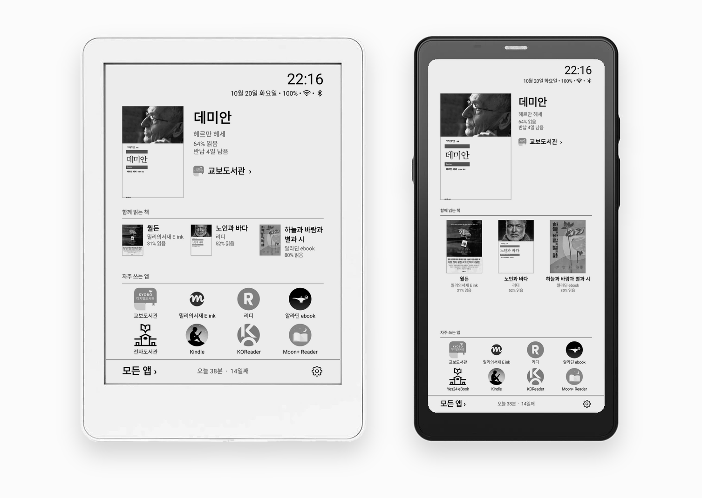

# Pebble Desk

**이북리더기를 위한 전자잉크 런처.** 교보도서관·밀리의서재·킨들 같은 이북 앱에서 편 책이 홈 화면에 들어오고, 책마다 읽은 시간이 남는다. → [pebbledesk.github.io](https://pebbledesk.github.io/)

[English](README.md)

<p align="center"></p>

## 기능

- **지금 읽는 책을 홈에**: 표지·제목·저자·진행률·반납일을 크게. 다른 책은 `함께 읽는 책` 줄에. 책을 누르면 그 앱이 열린다.
- **읽는 책 자동 추가**: [지원하는 앱](#지원하는-앱)에서 책을 펴면 표지와 함께 홈에 들어온다. 다른 앱의 책은 표지를 찾아 직접 넣는다.
- **책마다 읽은 시간**: 읽는 화면이 떠 있던 시간만 센다. 홈에 오늘 읽은 시간과 연속일, 독서 기록에 4주 달력·그래프, 하루 목표, 주·월·해 합계.
- **완독**: 반 개 단위 별점과 짧은 감상. 다시 읽으면 회차마다 기록이 따로 남는다.
- **올해 읽은 책**: 그해 읽었거나 완독한 책을 목록·표지 격자로. 지난해도 고를 수 있다.
- **자주 쓰는 앱·모든 앱**: 직접 정한 순서와 이름, 목록·격자. 모든 앱은 쪽으로 나누고 색인 글자로 건너뛴다. 안 쓰는 앱은 숨긴다.
- **전자잉크에 맞춤**: 흑백, 애니메이션 없음, 스크롤 대신 쪽, 바뀐 곳만 다시 그린다.
- **화면**: 글자 크기 70–150%·줄 간격 80–150%, 컬러 전자잉크용 색, 가로 화면·바형 화면.
- **기기**: 크레마 페블 기준으로 만들고, 다른 안드로이드 전자잉크 기기(BOOX·메이북 등)는 같은 폭으로 맞춘다.
- **기기 안에만**: 기록은 밖으로 보내지 않는다. 업데이트는 앱 안에서 받아 설치한다.

| 홈 | 독서 기록 | 독서 기록(그래프) | 올해 읽은 책 |
|---|---|---|---|
|  |  |  |  |
| **책 상세** | **모든 앱** | **숨긴 앱** | **설정** |
|  |  |  |  |

## 지원하는 앱

앱마다 들어오는 책 정보(표지·제목·저자·진행률·반납일)는 설정 › 독서 › `자동 추가 안내`와 [docs/READER_APPS.md](docs/READER_APPS.md)에 있다.

<table>
<tr><td align="center" width="96"><br><sub>교보도서관</sub></td><td align="center" width="96"><br><sub>교보eBook</sub></td><td align="center" width="96"><br><sub>밀리의서재</sub></td><td align="center" width="96"><br><sub>알라딘</sub></td><td align="center" width="96"><br><sub>북커스</sub></td><td align="center" width="96"><br><sub>리디</sub></td><td align="center" width="96"><br><sub>YES24 전자도서관</sub></td></tr>
<tr><td align="center" width="96"><br><sub>my YES</sub></td><td align="center" width="96"><br><sub>YES24 eBook</sub></td><td align="center" width="96"><br><sub>Moon+ Reader</sub></td><td align="center" width="96"><br><sub>이지뷰어</sub></td><td align="center" width="96"><br><sub>채리뷰어</sub></td><td align="center" width="96"><br><sub>우주뷰어</sub></td><td align="center" width="96"><br><sub>Kindle</sub></td></tr>
<tr><td align="center" width="96"><br><sub>Libby</sub></td><td align="center" width="96"><br><sub>KOReader</sub></td><td align="center" width="96"><br><sub>Readest</sub></td><td align="center" width="96"><br><sub>BookFusion</sub></td><td align="center" width="96"><br><sub>Google Play 북</sub></td><td align="center" width="96"><br><sub>Mihon</sub></td><td align="center" width="96"><br><sub>Kahon</sub></td></tr>
<tr><td align="center" width="96"><br><sub>Kobo</sub></td></tr>
</table>

네오리더(BOOX)도 된다.

## 설치

1. [Releases](https://github.com/hissinger/pebble-desk/releases)에서 `PebbleDesk-<판>-release.apk` 를 받아 기기의 파일 관리자에서 눌러 설치한다. 다음 판부터는 설정 › 정보 › `업데이트`에서 받는다.
2. 설정 › 앱 관리 › `기본 홈 앱`에서 Pebble Desk 를 고른다.
3. 처음 뜰 때 `시작하기`가 기본 기능 두 가지를 켜게 한다: **읽는 책 자동 추가**(안드로이드 접근성)와 **오늘 읽은 시간**(사용 기록 액세스). 안드로이드 13 이상에서 파일로 깐 앱은 먼저 앱 정보에서 **제한된 설정 허용**이 필요할 수 있다.

문제가 생기면 [docs/TROUBLESHOOTING.md](docs/TROUBLESHOOTING.md)를 보고, 그래도 안 되면 설정 › `기기 정보` 화면을 사진으로 찍어 보낸다.

## 권한

| 권한 | 쓰는 곳 |
|---|---|
| 접근성 서비스 (선택) | 읽는 책 자동 추가. 지원하는 이북 앱 화면만, 책 정보(제목·저자·진행률·반납일·표지)만 읽고 본문은 보지 않는다 |
| 사용 기록 액세스 (선택) | 오늘 읽은 시간 |
| 모든 파일에 액세스 (선택) | `책 파일 읽기`: KOReader 의 기록, 책 파일의 표지, Readest 데이터. 읽기만 한다 |
| 인터넷 | 표지 검색, 업데이트 확인, 만화 표지 풀기 도구(libarchive) 받기 |

## 빌드

Android Studio의 JDK로 빌드한다(minSdk 28, targetSdk 34).

```bash
export JAVA_HOME="/Applications/Android Studio.app/Contents/jbr/Contents/Home"
./gradlew assembleRelease
adb install -r app/build/outputs/apk/release/PebbleDesk-<판>-release.apk
```

화면 규격과 동작의 기준은 [DESIGN.md](DESIGN.md), 기기별 호환 조사는 [docs/DEVICES.md](docs/DEVICES.md)에 있다.

## 라이선스

[PolyForm Noncommercial 1.0.0](LICENSE). 개인 용도(취미·공부·연구)와 비영리 단체(학교·공공기관·자선 단체 등)는 자유롭게 쓰고, 고치고, 나눌 수 있다. 나눌 때는 이 라이선스와 `Required Notice` 줄을 함께 전한다.

상업적 이용(판매, 유료 제품·서비스에 넣기, 회사의 영리 업무에 쓰기 등)은 허용하지 않는다. 필요하면 [GitHub 이슈](https://github.com/hissinger/pebble-desk/issues)로 따로 문의한다.

`docs/screenshots/` 의 화면 그림에 보이는 책 표지·다른 앱 아이콘과, `hero-*.png` 의 기기 틀(크레마 페블은 YES24 상품 사진, BOOX 팔마는 BOOX 공식 사진)은 위 라이선스가 아니며 각 권리자의 것이다.

완독 도장 그림(`app/src/main/res/drawable-nodpi/stamp_completed.png`)은 위 라이선스가 아니다. Pixabay의 [TheDigitalArtist 'Approved Stamp'](https://pixabay.com/illustrations/approved-stamp-approval-business-5254258/)([Pixabay Content License](https://pixabay.com/service/license-summary/))를 고친 것이다(가운데 글자를 `COMPLETED`로, 흑백, `tools/stamp_completed.py`).

만화 표지 압축 해제용 libarchive 의 Java 부분(`app/src/main/java/me/zhanghai/android/libarchive/`)은 [libarchive-android](https://github.com/zhanghai/libarchive-android)(Apache-2.0)를 가져와 네이티브 라이브러리를 부르는 한 줄만 고친 것이다. 네이티브 라이브러리 `libarchive-jni.so` 는 앱에 넣지 않고 사용자가 설정에서 받는다(이 저장소의 릴리스 [`libarchive-1.1.7`](https://github.com/hissinger/pebble-desk/releases/tag/libarchive-1.1.7), 그 안의 libarchive·bzip2·xz·lz4·zstd·Mbed TLS·zlib 라이선스는 같은 릴리스의 `NOTICE.txt`, 만드는 법은 `tools/libarchive/make-assets.sh`).

시작하기 화면의 예시 책 표지(`app/src/main/res/drawable-nodpi/sample_cover.jpg`)는 윤동주 『하늘과 바람과 별과 시』(정음사, 1948) 초판 표지로, 국립한글박물관 아카이브의 스캔을 Wikimedia Commons 에 올린 [퍼블릭 도메인 파일](https://commons.wikimedia.org/wiki/File:%EC%9C%A4%EB%8F%99%EC%A3%BC_%ED%95%98%EB%8A%98%EA%B3%BC_%EB%B0%94%EB%9E%8C%EA%B3%BC_%EB%B3%84%EA%B3%BC_%EC%8B%9C_(%EC%B4%88%ED%8C%90%EB%B3%B8,_1948).pdf)을 흑백으로 줄인 것이다(`tools/sample_cover.py`).
