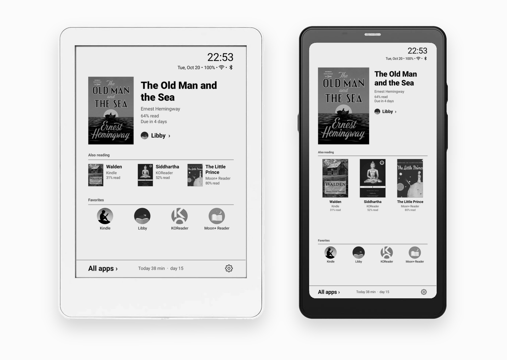
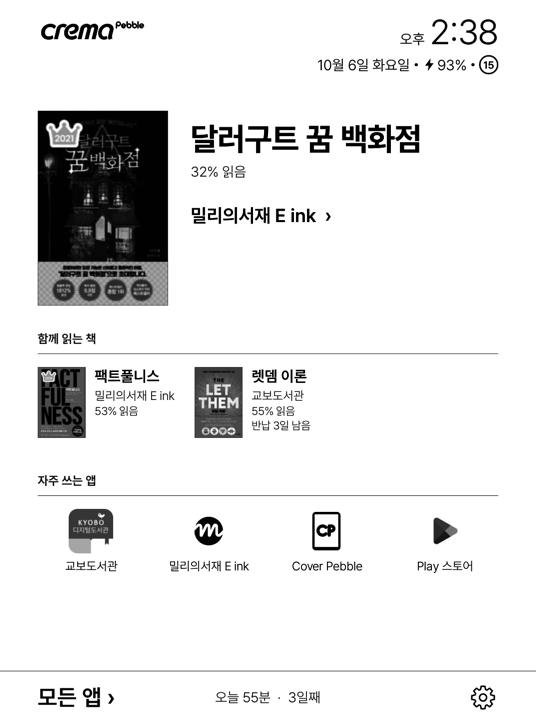
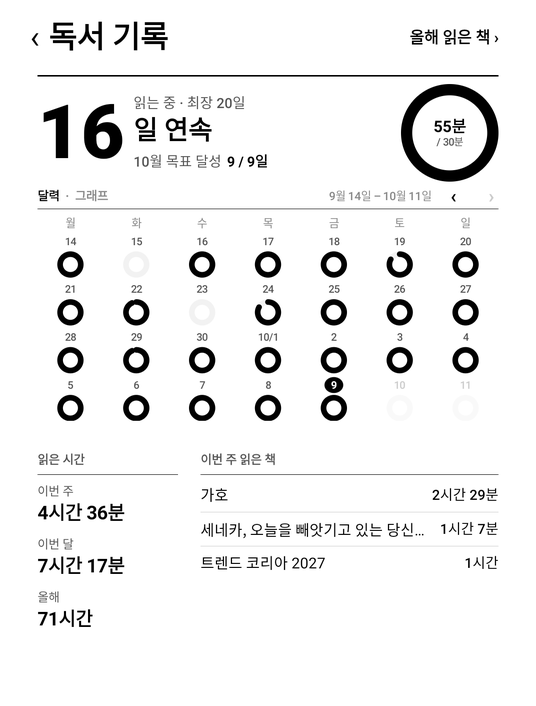
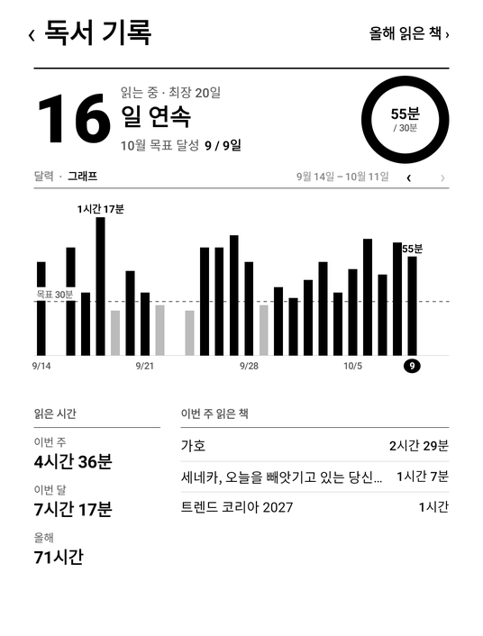
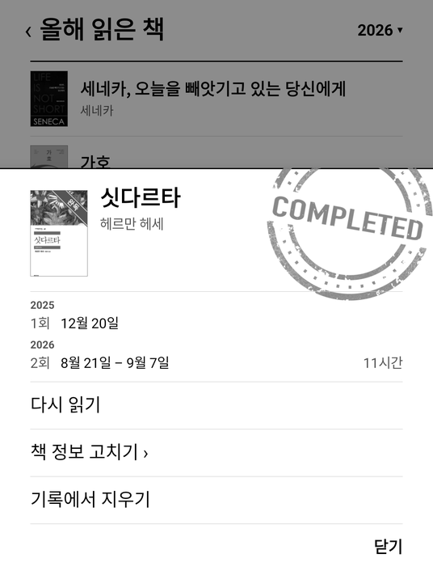
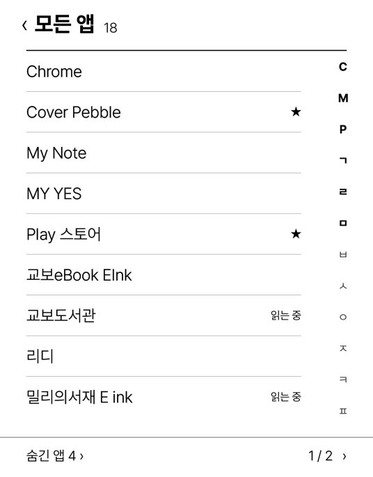
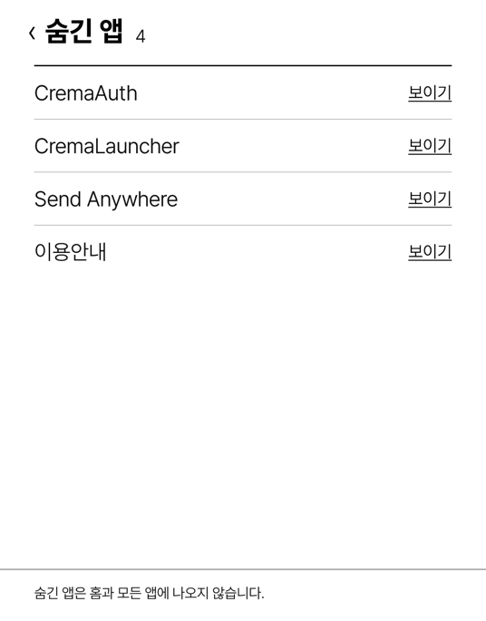
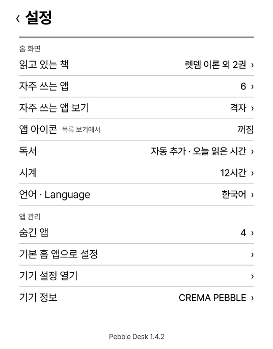

# Pebble Desk

**An E Ink launcher for Android e-readers.** Books you open in Kindle, Libby, KOReader and other reading apps appear on your home screen, and reading time is kept for every book. → [pebbledesk.github.io](https://pebbledesk.github.io/en/)

[한국어](README.ko.md)

<p align="center"></p>

## Features

- **The book you're reading, on Home**: cover, title, author, progress and due date, big. More books sit under `Also reading`. Tap a book to open its app.
- **Auto-add books**: open a book in a [supported app](#supported-apps) and it's added to Home with its cover. Books from other apps can be added by hand, with cover search.
- **Reading time for every book**: counts only the time the reading screen is up. Today's time and your streak on Home; a reading log with a four-week calendar or graph, a daily goal and weekly totals.
- **Finish a book**: rate it in half stars and write a few words. Read it again and each round keeps its own record.
- **Books this year**: every book you read or finished, as a list or a cover grid, for any year.
- **Favorites and All apps**: your own order and names, list or grid. All apps by page with a letter index. Hide apps you don't use.
- **Made for E Ink**: black and white, no animation, pages instead of scrolling, and only what changed is redrawn. To turn pages with hardware buttons (volume keys, page buttons), press the buttons you want in Settings.
- **Display**: text size 70–150% and line spacing 80–150%, an optional color theme for color E Ink, icon packs (such as Arcticons) with per-app icons, landscape and tall (bar-shaped) screens.
- **Devices**: designed for the Crema Pebble; other Android E Ink devices (BOOX, Meebook and others) are scaled to the same width.
- **Stays on the device**: your log is never sent anywhere. Updates install from inside the app.

| Home | Reading log | Reading log (graph) | Books this year |
|---|---|---|---|
|  |  |  |  |
| **Book details** | **All apps** | **Hidden apps** | **Settings** |
|  |  |  |  |

## Supported apps

What each app provides (cover, title, author, progress, due date) is shown in Settings › Reading › `How auto-add works` and in [docs/READER_APPS.md](docs/READER_APPS.md) (Korean).

<table>
<tr><td align="center" width="96"><br><sub>Kindle</sub></td><td align="center" width="96"><br><sub>Kobo</sub></td><td align="center" width="96"><br><sub>Libby</sub></td><td align="center" width="96"><br><sub>KOReader</sub></td><td align="center" width="96"><br><sub>Readest</sub></td><td align="center" width="96"><br><sub>BookFusion</sub></td><td align="center" width="96"><br><sub>Google Play Books</sub></td></tr>
<tr><td align="center" width="96"><br><sub>Mihon</sub></td><td align="center" width="96"><br><sub>Kahon</sub></td><td align="center" width="96"><br><sub>Moon+ Reader</sub></td><td align="center" width="96"><br><sub>EzViewer</sub></td><td align="center" width="96"><br><sub>CherieViewer</sub></td><td align="center" width="96"><br><sub>Woojoo</sub></td><td align="center" width="96"><br><sub>Kyobo Library</sub></td></tr>
<tr><td align="center" width="96"><br><sub>Kyobo eBook</sub></td><td align="center" width="96"><br><sub>millie</sub></td><td align="center" width="96"><br><sub>Aladin</sub></td><td align="center" width="96"><br><sub>Bookers</sub></td><td align="center" width="96"><br><sub>RIDI</sub></td><td align="center" width="96"><br><sub>YES24 Library</sub></td><td align="center" width="96"><br><sub>my YES</sub></td></tr>
<tr><td align="center" width="96"><br><sub>YES24 eBook</sub></td><td align="center" width="96"><br><sub>Futon</sub></td><td align="center" width="96"><br><sub>Kotatsu</sub></td></tr>
</table>

NeoReader (BOOX) is supported too.

## Install

1. Download `PebbleDesk-<version>-release.apk` from [Releases](https://github.com/hissinger/pebble-desk/releases) and tap it in a file manager on the device. Later versions install from Settings › About › `Update`.
2. Choose Pebble Desk in Settings › Apps › `Default home app`.
3. On first run, `Getting started` turns on the two core features: **Auto-add books** (Android Accessibility) and **Reading time** (Usage access). On Android 13 and later, an app installed from a file may need **Allow restricted settings** in its app info first.

If something goes wrong, see [docs/TROUBLESHOOTING.md](docs/TROUBLESHOOTING.md) (Korean), or send a photo of Settings › `Device info`.

## Permissions

| Permission | Used for |
|---|---|
| Accessibility service (optional) | Auto-add books. Only supported e-book apps are watched, and only book info (title, author, progress, due date, cover), never the book's text |
| Usage access (optional) | Reading time |
| All files access (optional) | `Read book files`: KOReader's records, covers from book files, Readest data. Read only |
| Internet | Cover search, update check, and downloading the comic cover unpacking tool (libarchive) |

## Build

Build with Android Studio's JDK (minSdk 28, targetSdk 34).

```bash
export JAVA_HOME="/Applications/Android Studio.app/Contents/jbr/Contents/Home"
./gradlew assembleRelease
adb install -r app/build/outputs/apk/release/PebbleDesk-<version>-release.apk
```

Design and behavior are specified in [DESIGN.md](DESIGN.md); device notes are in [docs/DEVICES.md](docs/DEVICES.md) (both Korean).

## License

[PolyForm Noncommercial 1.0.0](LICENSE). Individuals (hobby, study, research) and noncommercial organizations (schools, public institutions, charities, etc.) may use, modify and share it freely. When sharing, pass on this license and the `Required Notice` line.

Commercial use (selling it, including it in a paid product or service, using it for a company's for-profit work, etc.) is not allowed. If you need it, ask through [GitHub issues](https://github.com/hissinger/pebble-desk/issues).

The screen images in `docs/screenshots/` show book covers and other apps' icons, and the device frames in `hero-*.png` are product photos of the Crema Pebble (YES24) and the BOOX Palma (Onyx BOOX). These are not under the license above and belong to their owners.

The completed stamp (`app/src/main/res/drawable-nodpi/stamp_completed.png`) is not under the license above. It is a modified version of [TheDigitalArtist's 'Approved Stamp'](https://pixabay.com/illustrations/approved-stamp-approval-business-5254258/) on Pixabay ([Pixabay Content License](https://pixabay.com/service/license-summary/)) (center text changed to `COMPLETED`, black and white, `tools/stamp_completed.py`).

The Java part of libarchive for unpacking comic covers (`app/src/main/java/me/zhanghai/android/libarchive/`) is taken from [libarchive-android](https://github.com/zhanghai/libarchive-android) (Apache-2.0) with one line changed where it loads the native library. The native library `libarchive-jni.so` is not bundled; users download it in Settings (this repository's release [`libarchive-1.1.7`](https://github.com/hissinger/pebble-desk/releases/tag/libarchive-1.1.7); licenses for libarchive, bzip2, xz, lz4, zstd, Mbed TLS and zlib are in that release's `NOTICE.txt`; built with `tools/libarchive/make-assets.sh`).

The sample book cover on the Getting started screens (`app/src/main/res/drawable-nodpi/sample_cover.jpg`) is the first-edition cover of Yun Dong-ju's *Sky, Wind, Stars and Poems* (Jeongeumsa, 1948), a black-and-white reduction of the [public domain file](https://commons.wikimedia.org/wiki/File:%EC%9C%A4%EB%8F%99%EC%A3%BC_%ED%95%98%EB%8A%98%EA%B3%BC_%EB%B0%94%EB%9E%8C%EA%B3%BC_%EB%B3%84%EA%B3%BC_%EC%8B%9C_(%EC%B4%88%ED%8C%90%EB%B3%B8,_1948).pdf) on Wikimedia Commons, scanned by the National Hangeul Museum archive (`tools/sample_cover.py`).
